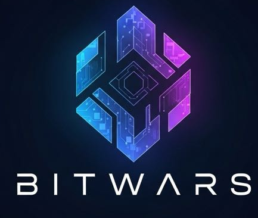

<div align="center">
  
  
  <h1>
    <span style="color: #00BFFF;">P</span><span style="color: #00BFFF;">R</span><span style="color: #1E90FF;">O</span><span style="color: #4169E1;">Y</span><span style="color: #8A2BE2;">E</span><span style="color: #9370DB;">C</span><span style="color: #BA55D3;">T</span><span style="color: #DA70D6;">O</span> 
    <span style="color: #C0C0C0;">B</span><span style="color: #C0C0C0;">I</span><span style="color: #C0C0C0;">T</span><span style="color: #C0C0C0;">W</span><span style="color: #C0C0C0;">A</span><span style="color: #C0C0C0;">R</span><span style="color: #C0C0C0;">S</span>
  </h1>
  
  <h3>El Grupo Bitwars</h3>
  <p><strong>Cohorte 2025 | Cuarto Semestre | Tecnicatura Universitaria en Programación</strong></p>
  
  <p>
    
    
    
  </p>
  
  <p>
    
    
    
    
    <br>
    
    
    
    
    <br>
    
    
    
  </p>
</div>

---

## 📖 Sobre el Proyecto

**Bitwars** es el proyecto integrador desarrollado por el **Grupo Bitwars** para la **Cohorte 2025** en el **Cuarto Semestre** de la **Tecnicatura Universitaria en Programación** de la **Universidad Tecnológica Nacional (UTN) - Regional San Rafael, Mendoza**.

El proyecto tiene un enfoque multidisciplinario y multilenguaje, donde se aplican diferentes tecnologías para resolver problemáticas específicas, acompañadas de una sólida base metodológica. El repositorio está organizado en **carpetas independientes** dentro de la rama principal (`main`), una por cada tecnología.

---

## 🏫 Información Institucional

| 🏛️ Universidad | 📍 Facultad / Región | 🎓 Carrera | 📚 Materia | 📅 Cohorte / Semestre |
| :--- | :--- | :--- | :--- | :--- |
| **UTN (Universidad Tecnológica Nacional)** | Regional San Rafael - Mendoza, Argentina | Tecnicatura Universitaria en Programación | Programación IV, Analisis y Gestion de Datos, Legislación, Metodología | Cohorte 2025 - Cuarto Semestre |

---

## 👥 Integrantes del Grupo "Bitwars"

| 👤 Nombre y Apellido | 💻 Rol | 🔗 GitHub |
| :--- | :--- | :--- |
| **Tomás Vilche** | Desarrollo | [@tomasVilche](https://github.com/tomasVilche) |
| **Franchesco Cornachione** | OWER / Líder | [@fran-cornachione](https://github.com/fran-cornachione) |
| **Valentín Castillo** | Desarrollo | [@colo-castillo](https://github.com/colo-castillo) |
| **Damián Ponce de León** | Desarrollo | [@Clarionda](https://github.com/Clarionda) |
| **Pablo García** | Desarrollo | [@pablodgarcia21](https://github.com/pablodgarcia21) |

---

## 📂 Estructura del Repositorio

Todo el proyecto vive en la rama `main`, organizado por carpetas según tecnología:

```text
Bitwars-Cuarto-Semestre/
│
├── ☕ java/               --> Desarrollo en Java (Spring Boot / Swing)
├── 🐍 python/             --> Desarrollo en Python
├── 🟨 javascript/         --> Desarrollo en JavaScript (Frontend / Node.js)
├── 🗄️ base-de-datos/      --> Scripts y esquemas (PostgreSQL, MySQL, MongoDB)
└── 📚 metodologia/        --> Documentación y metodología
    ├── 📁 subcarpeta1/
    │   └── 🌐 index.html
    ├── 📁 subcarpeta2/
    │   └── 🌐 index.html
    └── 📁 subcarpeta3/
        └── 🌐 index.html

🛠️ Tecnologías Utilizadas
Categoría	Tecnología	Descripción
Lenguajes	Java	Lógica de programación orientada a objetos y backend.
	Python	Scripting, automatización y análisis de datos.
	JavaScript	Interactividad, desarrollo web y frontend.
	HTML5	Documentación, estructura web y planificación.
Frameworks / Entornos	Spring Boot	Framework para el desarrollo de aplicaciones backend en Java.
	Node.js	Entorno de ejecución para JavaScript del lado del servidor.
	Java Swing	Librería gráfica para la creación de interfaces de escritorio en Java.
Bases de Datos	PostgreSQL	Sistema de gestión de bases de datos relacional avanzado.
	MySQL	Sistema de gestión de bases de datos relacional.
	MongoDB	Base de datos NoSQL orientada a documentos.
Herramientas	Git	Control de versiones distribuido para el trabajo en equipo.


🚀 Clonar y Navegar el Proyecto

Para obtener una copia local del proyecto, ejecutá en tu terminal:

git clone https://github.com/HotCode2025/Bitwars-Cuarto-Semestre.git
cd Bitwars-Cuarto-Semestre

Cada carpeta es independiente, podés entrar directamente a la que te interese:
bash

# Ir a la carpeta de Java
cd java

# Ir a la carpeta de Python
cd python

# Ir a la carpeta de JavaScript
cd javascript

# Ir a la carpeta de Metodología (archivos HTML)
cd metodologia